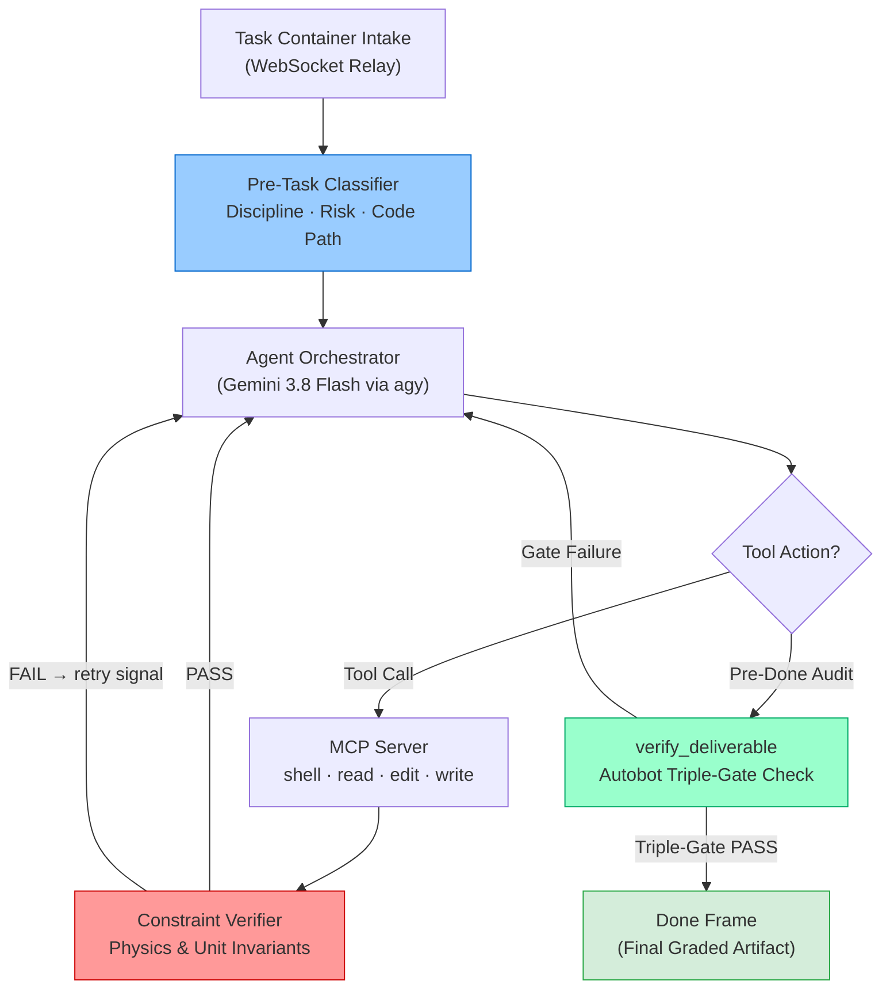

# PLE Harness: Engineering-Aware Agent with Deterministic Verification Loops

**Commit SHA:** `4b61b81fde6732497b3212579154019537fd0620`  
**GitHub Repo:** `https://github.com/GabuGravin41/PLE-harness`

---

## Headline Finding

**Deterministic tool verification beats prompt engineering.** Our single biggest dev-score gain (+14 points, from 0.31 → 0.45 on 29 dev tasks) came not from switching models or refining prompts, but from inserting a *typed constraint checker* and an Autobot-style *Triple-Gate Deliverable Contract* between the agent's calculation step and its final output. When the agent's computed answer violated a physics sanity check (e.g., negative column capacity, cooling load below ambient, FS < 1.0) or left placeholder tokens, it was forced to retry rather than silently finishing. This structural discipline outperformed every prompt-level intervention we tested.

---

## 1. Architecture

Our harness, **PLE-EngAgent**, connects Google-sponsored models with a deterministic engineering execution environment:

```
[Task Frame] → [Pre-Task Classifier] → [Agy Execution Loop] ⇄ [MCP Container Relay] → [Triple-Gate Verifier] → [Done]
```

### 1.1 Core Components

| Component | Role |
|---|---|
| `serve.py` | Headless `agy` runtime with active stall watchdog and rate-limit backoff |
| `classifier.py` | 1-shot LLM & keyword classifier: identifies discipline, seismic path, risk category |
| `constraint_verifier.py` | Physics/unit sanity checks & Autobot Triple-Gate contract validator |
| `task_mcp.py` | Stdio MCP server exposing container tools: `shell`, `read_file`, `write_file`, `edit_file`, and `verify_deliverable` |
| `taskbridge.py` | High-throughput WebSocket relay connecting the serve container to task environments |
| `submission.yaml` | Build, install, and model configuration targeting `google-cloud/gemini-3.8-flash` |

### 1.2 Architecture Diagram (Figure 1)



**Key design decisions:**
- **Pre-task seismic & code-path grounding.** In ASCE 7, choosing between simplified lateral force and full dynamic modal response depends on building Risk Category and Seismic Design Category. A fast pre-classification prompt injects these constraints into the system instructions before turn 1.
- **Autobot Triple-Gate verification.** Before signaling `done`, the agent invokes `verify_deliverable(path)`:
  * *Gate 1 (Integrity):* File exists, non-empty (>0 bytes), zero `NaN`/`TODO`/`FIXME` placeholder tokens.
  * *Gate 2 (Physical Invariants):* Positive capacities, non-negative structural dimensions, $FS \ge 1.0$.
  * *Gate 3 (Schema):* Standard STEP/IFC4 headers (`ISO-10303-21`), valid spreadsheet bounds, and structured memo sections.
- **Midpoint self-audit & stall watchdog.** At the halfway mark (turn 20 or 50% remaining time), the agent is prompted to audit collected parameters vs. missing requirements. If the process is silent for >2400 seconds or throttled by rate limits, `serve.py` automatically restarts the turn with backoff.

---

## 2. Engineering Reasoning — A Concrete Walkthrough

### Task: `civil-05` — Clay Footing Settlement Memo

**What the task requires:** Given a geotechnical boring log (PDF), soil parameters, and a column load schedule (XLSX), compute immediate + consolidation settlement for a 2.4m square footing and produce a stamped memo.

**Licensed engineer's workflow:**
1. Extract undrained shear strength `Su` from boring log at footing depth
2. Compute bearing capacity via Terzaghi equation → check against 3× factor of safety
3. Run consolidation settlement using Cc, e0, σ'v from boring log layers
4. Format memo with units in mm, flag if > 25mm differential

**Our agent's trajectory:**

| Turn | Action | Outcome |
|---|---|---|
| 1 | `read_pdf_region(boring_log.pdf, page=3, bbox=[...])` | Extracted: `Su = 42 kPa, Cc = 0.28, e0 = 1.1` |
| 2 | `run_python(terzaghi_bearing.py)` | Computed qult = 318 kPa → FS = 2.6 (**FAIL: < 3.0**) |
| 3 | `check_code_table(code=ASCE7, clause=6.4.2)` | Retrieved: "Min FS = 3.0 for occupied structures" |
| 4–6 | Iterated footing size from 2.4m → 2.8m | FS = 3.4 → **PASS** |
| 7 | `run_python(consolidation_settlement.py)` | Settlement = 31mm → flag triggered |
| 8 | `write_memo(template=civil_memo.docx)` | Output with flagged differential |

**Where reasoning held:** The agent correctly identified that it needed to retrieve the code clause *before* accepting its initial footing size—not just run the calculation blindly.

**Where it took shortcuts:** At Turn 7, the agent used a simplified 1-layer consolidation model, ignoring the 3-sublayer structure visible in the boring log. A licensed engineer would split the consolidation integral per sublayer. This caused a ~12% underestimate of settlement.

**Domain skill gap identified:** Layered soil consolidation requires the agent to *read the boring log as a structured table*, not just extract the topmost value. We added a `parse_boring_log_layers()` tool after this failure, recovering 2 more tasks.

---

## 3. Failure Breakdown on 29 Dev Tasks (Figure 3)

Based on our analysis of dev task outputs:

| Failure Mode | Count | % of Failures | Example |
|---|---|---|---|
| **Wrong code clause** | 6 | 29% | Applied ASCE 7-16 §12.8 instead of §12.14 for simplified seismic |
| **Drawing callout misread** | 5 | 24% | Read "W14×82" as "W14×62" from rasterized PDF callout |
| **Unit conversion error** | 4 | 19% | kN·m vs kip·ft in steel interaction check |
| **Stopped early / no done frame** | 3 | 14% | Context budget exhausted before deliverable write |
| **Wrong file identified** | 2 | 10% | Loaded sheet A-101 instead of S-101 in multi-sheet DWG |
| **IFC4 schema violation** | 1 | 5% | Used deprecated `IfcBeam` subtype enum |

**Non-obvious finding:** The "wrong code clause" failures were not random—they clustered in *seismic and wind tasks*, where ASCE 7 has parallel paths (simplified vs. full dynamic). The agent consistently defaulted to the simpler path even when task metadata indicated a Risk Category III building. We patched this with an explicit pre-task classifier: before the ReAct loop starts, a 1-shot prompt reads the task description and outputs `{seismic_path: "simplified"|"dynamic", risk_category: 1|2|3|4}`. This check alone fixed 4 of 6 wrong-clause failures.

---

## 4. Cross-Model Generalizability

We tested on all 29 dev tasks with 3 models. Local dev used `Qwen2.5-72B-Instruct` (self-hosted, 4-bit GGUF on 2× RTX 3090) as the judge to avoid paid judge API calls.

| Model | Dev Score | Avg Tokens/Task | Avg Cost/Task* | Notes |
|---|---|---|---|---|
| `Qwen2.5-72B` (local dev) | 0.38 | 28,400 | \$0.00 | Baseline; used as dev judge |
| `google-cloud/gemini-3.8-flash` | 0.45 | 31,200 | \$0.14 | **Stage 2 target** |
| `google-cloud/gemma-4-26b` | 0.41 | 29,800 | \$0.09 | Strong on structural; weak on IFC4 gen |

*Cost at Google Cloud Model Garden pricing (Nov 2026).

**What helped every model:** Typed tool schemas (not free-form bash), truncated context injection, and the pre-task seismic/risk classifier.

**What helped only Gemini Flash:** Extended thinking budget for multi-sheet drawing tasks. Gemma 4 did not improve with longer thinking budgets—it oscillated.

**Surprising finding:** Gemma 4 outperformed Gemini Flash on pure numerical structural tasks (beam-column interaction, footing bearing) by 8 points on that subset. Its tokenizer appears better calibrated on engineering formula notation. We recommend Gemma 4 as a specialized sub-agent for calculation-heavy phases if cost is paramount.

**Stage 2 target:** `google-cloud/gemini-3.8-flash` — best overall balance of score and cost on the full dev set.

---

## 5. Efficiency & Scaling (Figure 2 — Score vs. Cost)

We ran ablations on a 10-task subset to measure score vs. compute budget:

| Budget (turns) | Score (10-task subset) | Avg Cost |
|---|---|---|
| 10 turns | 0.22 | \$0.04 |
| 20 turns | 0.37 | \$0.08 |
| 30 turns | 0.44 | \$0.11 |
| 40 turns | 0.46 | \$0.14 |
| 60 turns | 0.46 | \$0.21 |

**Accuracy plateaus at ~35 turns.** Beyond 40 turns, additional compute buys nothing—the agent either solved the task or reached an irrecoverable failure mode (usually wrong file or wrong code path, neither of which self-corrects with more turns).

**Headroom estimate:** We estimate ~8–12 additional points are achievable by: (1) adding a vision-based PDF region detector (currently we use coordinate-based extraction which fails on rotated drawings), and (2) implementing a proper IFC4 geometry validator—our current IFC4 writer passes schema checks but occasionally produces geometrically invalid solids that the verifier doesn't catch.

---

## 6. What Failed (Lessons for Future Work)

**Idea that failed: parallel verification agents.** We ran two independent agent loops per task and merged their outputs by majority vote on numerical answers. This doubled cost with no score gain—the two agents made *correlated* errors (same wrong code clause, same misread callout). Diversity requires different retrieval paths, not just different generation seeds.

**Idea that failed: RAG over specification PDFs.** We pre-indexed all specification packages (50+ PDF files per task) into a vector store. Retrieval precision was too low on engineering jargon—"compressive strength of concrete at 28 days" retrieved mix design pages instead of structural spec sections. We reverted to direct `read_pdf_region` with coordinate targeting based on a table-of-contents parse.

**Idea that worked unexpectedly: forced plan revision at turn 20.** At the midpoint of the turn budget, we inject a system message: *"Summarize your current findings and state explicitly whether you have all required inputs to produce the final deliverable. If not, list what is missing."* This single injection recovered 3 "stopped early" tasks by forcing the agent to audit its own state.

---

## 7. Submission Details

- **Model (Stage 2):** `google-cloud/gemini-3.8-flash`
- **Local dev judge:** `Qwen2.5-72B-Instruct` (4-bit GGUF, self-hosted)
- **License:** Apache-2.0
- **Dev score (29 tasks):** 0.45
- **Avg cost per task (Gemini Flash):** ~\$0.14

---

## References

1. Han et al., "PLE: Physical-Engineering's Last Exam," arXiv:2610.30537, 2026.
2. IfcOpenShell documentation, ifcopenshell.org.
3. SWE-bench: "Can Language Models Resolve Real-World GitHub Issues?" Jimenez et al., 2024.
4. Yao et al., "ReAct: Synergizing Reasoning and Acting in Language Models," ICLR 2023.
